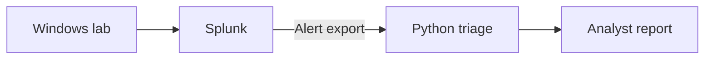

# Stage 4 — Feasibility and architecture

## Scope and acceptance

The first live scenario covers one Windows endpoint, Sysmon process creation (Event ID 1), PowerShell Script Block Logging (Event ID 4104), and one Splunk instance. The analyst must be able to explain why the rule fired, identify the evidence used for triage, and see gaps in collection.

| Requirement | Acceptance evidence |
| --- | --- |
| Collect the two Windows event types | Find a test event of each type in Splunk with the expected host and timestamp |
| Detect encoded PowerShell | Run the same SPL rule against an encoded invocation and a plain benign control. Record which case triggered |
| Preserve provenance | Produce a v0.1 dossier with the alert identity, process event, and source references. Record an unavailable parent or ambiguous script block explicitly |
| Replay the scenario | Record the commit, rule version, test data, and observed result so the same inputs can be replayed |

## Current path and target design

Today, the CLI reads a synthetic alert, validates it against the [v0.1 schema](../schemas/alert-envelope-0.1.schema.json), and emits a text or JSON report. Tests exercise Sysmon and 4104 normalization together. Live collection, automated Splunk queries, and the API are target components.

| Component | Interface and behavior |
| --- | --- |
| Windows and Splunk | Windows forwards Sysmon and 4104 events. The analyst exports selected events and alert metadata for the first live scenario |
| Normalization and validation | Adapt source fields to the existing `Evidence` model, then validate the v0.1 envelope. Evidence IDs are unique within the dossier. Preserve the original source reference |
| Evidence pivots | Identify the parent by matching the child's `ParentProcessGuid` to the parent's `ProcessGuid` on the same host. Treat nearby 4104 events as candidates. Time proximity alone cannot establish a process link |
| Report | Keep the detection signal, decode status, observed evidence, and missing evidence separate. Human review determines whether to escalate |
| Future service | A webhook may accept a validated alert and return HTTP 202 only after persisting a job. Use `(source, instance_id, alert_id)` as the deduplication key and record terminal failures for review |

## Security and feasibility

- Isolate the lab network. Keep Splunk searches read-only and limited to lab indexes when the connector is added. Restrict the host and time window for each search.
- Keep credentials and real event exports out of the public repository. Publish only synthetic fixtures or reviewed, sanitized evidence.
- The export-based path requires no paid model API. For a sizing exercise, 1,000 events per day at an average 2 KB each would produce about 14 MB of raw payload over seven days, before Splunk indexing, VM disks, and snapshots. These figures are assumptions for planning.
- On a lab host with 16 GB RAM, an initial sizing scenario is 4 GB for Windows, 8 GB for Splunk and Python, and 4 GB left for the host and headroom. Treat this as a configuration to evaluate, with no concurrent AD VM in the first scenario. If the host swaps heavily or cannot run both workloads reliably, collect and replay in separate sessions.
- Before moving to live collection, record the host CPU, available RAM and disk, and the hypervisor in use. In a pilot, measure peak host and guest memory, free disk, ingest delay, search latency, and CLI wall-clock time. Set throughput and latency targets after the pilot.
- If an LLM is added later, send only selected evidence under a token and spending cap. Estimate spend as the sum of input and output tokens multiplied by their respective per-token rates. Set the cap and record the chosen model's rate before enabling external calls.

The architecture choice is recorded in [ADR 0001](adr/0001-export-based-triage.md). The current validation status is tracked in [PROJECT_STATUS.md](PROJECT_STATUS.md).
